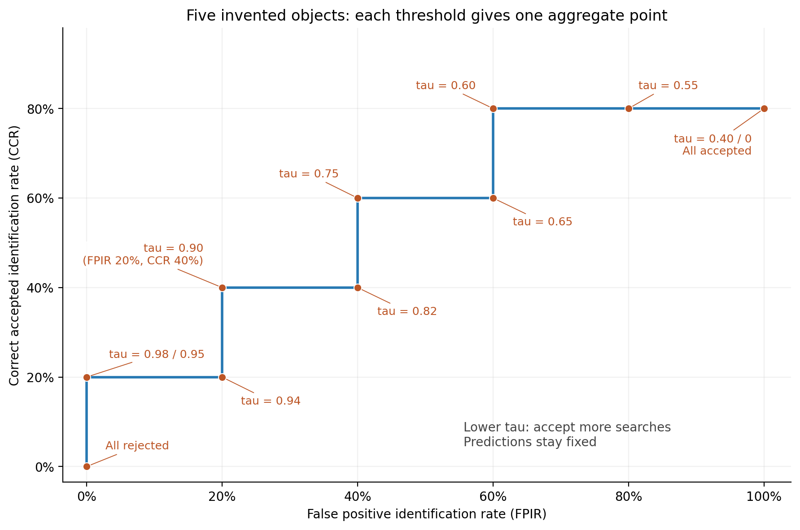
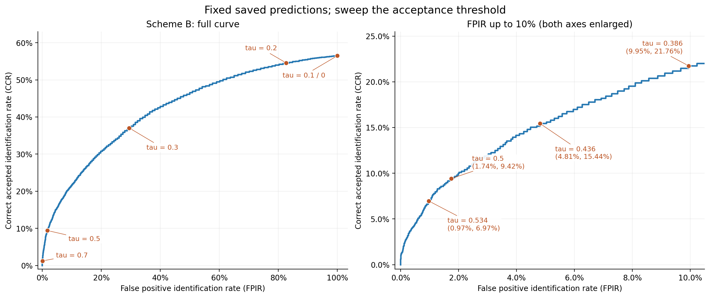

# 如何理解 CCR–FPIR 曲线中的每个点，以及概率阈值

本文对应当前 **Scheme B / Probability** 分析，结合 [index.html](index.html) 的五样本教学例子和当前保存的真实结果，逐步说明概率阈值如何生成曲线。

数据核对日期：2026-11-09。

**先记住一句话：选定一个概率阈值，对全部 present 和 absent 搜索分别统计，就得到曲线上的一个点；改变阈值并重复统计，就得到整条曲线。**

曲线点表示某个阈值下的总体表现。它不表示某一个人、某一个物体样本，也不表示某一次随机抽取候选人的实验。


## 1. 概率阈值到底用在哪里？

### 1.1 先预测，再决定是否接受

假设物体样本来自真实接触者 H1。模型面对 10 个候选人，输出以下概率。**本小节数字为教学假设。**

| 候选人 | 模型预测概率 |
|---|---:|
| H1 | 0.60 |
| H2 | 0.12 |
| H3 | 0.08 |
| H4 | 0.06 |
| H5 | 0.04 |
| H6 | 0.03 |
| H7 | 0.02 |
| H8 | 0.02 |
| H9 | 0.02 |
| H10 | 0.01 |
| **合计** | **1.00** |

模型概率最高的候选人是 H1，称为 TOP1；用于接受或拒绝的分数是最大概率：

```text
TOP1 = H1
score = max(10 个候选人的预测概率) = 0.60
```

概率阈值记作 τ，读作 tau。当前规则是：

```text
如果 score >= τ：接受 TOP1，报告这个候选人。
如果 score <  τ：拒绝，报告“没有可靠匹配”。
```

对同一次预测，使用不同阈值，会有不同决定：

| 阈值 τ | 比较 | 最终决定 |
|---:|---|---|
| 0.70 | 0.60 < 0.70 | 拒绝 |
| 0.60 | 0.60 ≥ 0.60 | 接受 H1 |
| 0.50 | 0.60 ≥ 0.50 | 接受 H1 |

这里使用的是 **≥，等于阈值也接受**。

### 1.2 阈值不会改变谁是 TOP1

在这次阈值扫描中，模型输出的概率和 TOP1 已经保存。把阈值从 0.70 调成 0.50，只改变最终的接受或拒绝决定，不重新训练模型，也不把原本预测错误的身份改成正确身份。

如果模型最高概率给了错误的人，例如 H8 得到 0.60，那么 τ = 0.50 会接受错误的 H8，τ = 0.70 则会拒绝。

所以“超过概率阈值”只意味着达到接受门槛，不能保证身份正确。最大预测概率也不自动等于经过校准的“此身份正确的实际概率”。

## 2. 为什么同一个样本需要 present 和 absent 两种搜索？

以 H1 接触的同一个物体样本为例：

| 条件 | 10 个候选人的组成 | 需要评价什么 |
|---|---|---|
| present | H1 + 另外 9 人 | 是否能正确识别 H1，并且接受这个结果？ |
| absent | 替代者 H11 + 同样的另外 9 人 | H1 不在候选人中时，是否仍错误接受了某个候选人？ |

当前 Scheme B 会分别用这两个 10 人组合训练模型。同一轮内共享 9 人，另外 1 人分别是真实接触者和替代者。下一轮重新抽取共享的 9 人和替代者。

在 present 条件下，可能出现三种最终结果：

| 最终结果 | 身份是否正确 | 达到阈值吗？ | 计入 CCR 分子吗？ |
|---|---|---|---|
| 正确且被接受 | 是 | 是 | **计入** |
| 错误但被接受 | 否 | 是 | 不计入 |
| 被拒绝 | TOP1 可能正确，也可能错误 | 否 | 不计入 |

在 absent 条件下，真实接触者根本不在候选人中，所以接受任意候选人都属于错误识别：

| 最终结果 | 计入 FPIR 分子吗？ |
|---|---|
| 达到阈值，接受某个候选人 | **计入** |
| 没达到阈值，拒绝 | 不计入 |

**计算同一个曲线点时，present 和 absent 必须使用同一个 τ。** 两组结果分别回答“能正确识别多少”和“会错误接受多少”。

## 3. 一个点的完整计算方式

令 present 搜索总数为 `N_present`，absent 搜索总数为 `N_absent`。固定阈值 τ 后：

```text
CCR(τ)
  = present 中“TOP1 正确，并且最大概率 >= τ”的搜索次数
    / 全部 present 搜索次数

FPIR(τ)
  = absent 中“最大概率 >= τ”的搜索次数
    / 全部 absent 搜索次数

曲线点 = (FPIR(τ), CCR(τ))
```

相应的数学表达式为：

$$
\mathrm{CCR}(\tau)=
\frac{\sum_{i=1}^{N_\mathrm{present}}
\mathbf{1}[\hat t_i^+=t_i\;\text{且}\;s_i^+\geq\tau]}
{N_\mathrm{present}}
$$

$$
\mathrm{FPIR}(\tau)=
\frac{\sum_{i=1}^{N_\mathrm{absent}}
\mathbf{1}[s_i^-\geq\tau]}
{N_\mathrm{absent}}
$$

其中，`s` 是最大预测概率，`t` 是真实接触者，`t̂` 是 TOP1；满足方括号内条件时记为 1，否则记为 0。

两个分母始终包含各自组内的全部搜索，包括被拒绝的搜索。**改变阈值会改变分子，分母保持固定。**

## 4. 详细教学例子：从五个样本算出一个点

下面沿用 [index.html](index.html) 中的五样本例子。**身份和数值均为虚构，仅用于解释计算，不是 Scheme B 的实际数据。**

### 4.1 已经保存好的预测结果

每行包含同一个物体的一次 present 搜索和一次 absent 搜索：

| 物体 | 真实接触者 | present TOP1 | present 最大概率 | present TOP1 正确吗？ | absent TOP1 | absent 最大概率 |
|---|---|---|---:|---|---|---:|
| O01 | P01 | P01 | 0.98 | 是 | P08 | 0.82 |
| O02 | P02 | P02 | 0.90 | 是 | P16 | 0.65 |
| O03 | P03 | P17 | 0.95 | **否** | P17 | 0.94 |
| O04 | P04 | P04 | 0.75 | 是 | P21 | 0.55 |
| O05 | P05 | P05 | 0.60 | 是 | P09 | 0.40 |

共有 5 次 present 搜索和 5 次 absent 搜索，因此两个指标各自的分母都是 5。

特别注意 O03：真实接触者是 P03，但 present 模型以 0.95 的高分预测 P17。这是一个“高置信度但错误”的结果。

### 4.2 固定 τ = 0.90：逐个判断 present

| 物体 | TOP1 / 分数 | 是否接受？ | 是否正确？ | 对 CCR 分子的贡献 |
|---|---|---|---|---:|
| O01 | P01 / 0.98 | 接受，0.98 ≥ 0.90 | 正确 | 1 |
| O02 | P02 / 0.90 | 接受，0.90 ≥ 0.90 | 正确 | 1 |
| O03 | P17 / 0.95 | 接受，0.95 ≥ 0.90 | 错误 | 0 |
| O04 | P04 / 0.75 | 拒绝，0.75 < 0.90 | TOP1 原本正确，但被拒绝 | 0 |
| O05 | P05 / 0.60 | 拒绝，0.60 < 0.90 | TOP1 原本正确，但被拒绝 | 0 |

因此：

```text
正确且接受 = 2 次
错误但接受 = 1 次
拒绝       = 2 次
总计       = 5 次

CCR(0.90) = 2 / 5 = 0.40 = 40%
```

O03 虽然被接受，但身份错误，不能贡献 CCR。O04 和 O05 虽然 TOP1 正确，但没有达到门槛，同样不能贡献 CCR。

### 4.3 同样固定 τ = 0.90：逐个判断 absent

| 物体 | absent 分数 | 是否接受？ | 对 FPIR 分子的贡献 |
|---|---:|---|---:|
| O01 | 0.82 | 拒绝 | 0 |
| O02 | 0.65 | 拒绝 | 0 |
| O03 | 0.94 | **接受 P17，但真实接触者 P03 不在候选人中** | 1 |
| O04 | 0.55 | 拒绝 | 0 |
| O05 | 0.40 | 拒绝 | 0 |

因此：

```text
错误接受 = 1 次
拒绝     = 4 次
总计     = 5 次

FPIR(0.90) = 1 / 5 = 0.20 = 20%
```

### 4.4 把两个结果放到图上

```text
阈值 τ = 0.90
         ↓
x = FPIR = 0.20
y = CCR  = 0.40
         ↓
图上的点：(0.20, 0.40)
```

这个点由全部 10 次搜索共同统计得到。它不能被理解成“O03 这个样本的点”。

### 4.5 为什么 CCR 不是 2/3？

这个阈值下，present 一共接受了 3 次，其中 2 次正确。

| 计算 | 结果 | 回答的问题 |
|---|---:|---|
| `2 / 全部 5 次 present 搜索` | 40% | 所有 present 搜索中，有多少被正确识别并接受？这是 **CCR**。 |
| `2 / 被接受的 3 次 present 搜索` | 66.67% | 在已接受的 present 结果里，有多少正确？这是另一个条件正确率。 |

本图的纵轴使用第一种计算。第二种数值也不能直接代表 present 和 absent 混合使用时的总体正确率。

## 5. 改变阈值，怎样得到整条曲线？

### 5.1 从 τ = 0.90 降到 0.80

present 中，仍只有 O01、O02、O03 被接受，其中正确的是 O01、O02，因此 CCR 仍为 2/5 = 40%。

absent 中，O01 的 0.82 现在也达到门槛；连同 O03，共错误接受 2 次，因此 FPIR = 2/5 = 40%。

于是点从 `(0.20, 0.40)` 移到 `(0.40, 0.40)`：向右移动，正确识别没有增加，错误接受增加了。

### 5.2 再降到 τ = 0.70

present 中，O04 的 0.75 达到门槛，并且身份正确。正确接受数从 2 变为 3，CCR = 3/5 = 60%。

absent 中，没有新分数跨过门槛，仍错误接受 2 次，FPIR = 40%。

于是点移到 `(0.40, 0.60)`：向上移动，增加了正确接受，没有增加 absent 错误接受。

### 5.3 再降到 τ = 0.60

present 中，O05 的 0.60 达到门槛，正确接受数变为 4，CCR = 80%。

absent 中，O02 的 0.65 也达到门槛，错误接受数变为 3，FPIR = 60%。

点变成 `(0.60, 0.80)`。这里比较的是两个相隔较远的阈值；完整扫描会显示其中的中间变化。

### 5.4 完整扫描表

只要阈值越过某个观测分数，接受集合就可能变化。按所有不同分数从高到低扫描，加上全部拒绝和全部接受的端点，可以得到完整经验曲线：

| 阈值 τ | present 正确且接受 | present 错误但接受 | absent 错误接受 | FPIR | CCR | 坐标 `(x, y)` |
|---:|---:|---:|---:|---:|---:|---|
| 高于所有分数 | 0 | 0 | 0 | 0% | 0% | `(0.00, 0.00)` |
| 0.98 | 1 | 0 | 0 | 0% | 20% | `(0.00, 0.20)` |
| 0.95 | 1 | 1 | 0 | 0% | 20% | `(0.00, 0.20)` |
| 0.94 | 1 | 1 | 1 | 20% | 20% | `(0.20, 0.20)` |
| 0.90 | 2 | 1 | 1 | 20% | 40% | `(0.20, 0.40)` |
| 0.82 | 2 | 1 | 2 | 40% | 40% | `(0.40, 0.40)` |
| 0.75 | 3 | 1 | 2 | 40% | 60% | `(0.40, 0.60)` |
| 0.65 | 3 | 1 | 3 | 60% | 60% | `(0.60, 0.60)` |
| 0.60 | 4 | 1 | 3 | 60% | 80% | `(0.60, 0.80)` |
| 0.55 | 4 | 1 | 4 | 80% | 80% | `(0.80, 0.80)` |
| 0.40 | 4 | 1 | 5 | 100% | 80% | `(1.00, 0.80)` |
| 0.00 | 4 | 1 | 5 | 100% | 80% | `(1.00, 0.80)` |



图中 `tau` 就是 τ。每个标记是一个实际计算得到的坐标；相邻点的连线用于展示扫描顺序。

### 5.5 为什么不同阈值可能落在同一个点？

有两种常见原因：

1. **接受集合没有变化。** 例如 τ = 0.90 和 τ = 0.85，五样本例子中的所有接受/拒绝决定相同，因此都是 `(0.20, 0.40)`。
2. **只新增了 present 中的错误接受。** 从 τ = 0.98 降到 0.95，O03 的错误 present 预测开始被接受，但 CCR 不计入它，absent 又没有新增接受，所以坐标仍是 `(0.00, 0.20)`。

因此，严格说是“一个阈值确定一个坐标”，但一个坐标可能对应多个阈值。只看 CCR–FPIR 两个数，也不能恢复 present 中所有错误接受的数量。

### 5.6 为什么线条呈阶梯状？

样本数有限，计数只能整数变化。教学例子的每组只有 5 次搜索，所以一次变化就是 1/5 = 20 个百分点。真实数据每组有 15,080 次搜索，单次贡献为 `1/15080 ≈ 0.00006631`，即约 0.006631 个百分点，曲线看起来就更密。

这里 `15080 = 754 份材料样本 × 每份 20 次候选组抽样`。present、absent 各有
15,080 次查询，两侧合计 30,160 次；计算 CCR 或 FPIR 时各用对应一侧的 15,080 作分母。
新增 1 次 absent 接受使 FPIR 增加 `1/15080`；新增 1 次 present 的 Top-k 正确接受
使 CCR 增加 `1/15080`。present 中新增的错误接受不增加 CCR。
把比例转成百分数要乘 100，因此 `0.00006631 × 100 = 0.006631%`，即增加约
0.006631 个百分点，而不是增加 0.006631 的比例值。这是单条查询的最小非零贡献；
实际台阶可能包含多条同分查询，并非每一步都只增加一条。20 次抽样不代表 20 个独立参与者。

如果多个搜索有相同分数，它们会同时跨过阈值，阶梯会更大。由于规则是 `>=`，同分搜索要一起接受，不能为了凑到指定 FPIR 而任意拆开。

当前图片用阶梯线连接计算点。**连线上的任意位置不一定是某个确定阈值实际能达到的结果；精确阈值和坐标应以 CSV 中的记录为准。**

对目前 Scheme B 的原始最高概率再核验：每侧 15,080 次查询的最高分均落在
`1/500 = 0.002` 的网格上。这来自当前 500 棵树的输出，不是画图时四舍五入；
一般随机森林的 `predict_proba` 是各树叶节点类别分布的平均，网格结论仅针对这批已核验预测。
present / absent 分别只有 343 / 266 个不同最高分，合并后只有 345 个分数值。
例如 τ 从 0.436 降到 0.434，一次新增 33 个 absent 接受，FPIR 从
`726/15080 = 4.8143%` 跳到 `759/15080 = 5.0332%`；Top-1 正确接受数同时从 2328 变成 2354。
在两阈值之间插入更多小数位不会拆开这些同分查询，因此不能靠更细扫描得到恰好 5% 的 FPIR。

Top-1/2/3 共用最高概率接受规则时，上述横向跳跃相同，只是纵向的正确接受数不同。
材料子集的查询分母更小，台阶可能更明显。图中的随机基线是解析期望
`CCR_k=(k/10)×FPIR`，所以是直线；它与有限样本的经验模型曲线外观不同是正常的。
样条平滑会引入实际 cutoff 未必可达到的位置，因此主图保留阶梯线。

## 6. 对应到当前 Scheme B 的实际数据

### 6.1 真实曲线的分母是什么？

当前分析包括：

| 内容 | 数量 |
|---|---:|
| 有单人接触物体样本的目标人 | 52 人 |
| 单人接触物体样本 | 754 个 |
| 每个物体的候选组合重复次数 | 20 次 |
| 每次搜索的候选人数 | 10 人 |
| present 搜索总数 | 754 × 20 = **15,080** |
| absent 搜索总数 | 754 × 20 = **15,080** |
| 成对记录数 | **15,080 行**，每行各含一次 present 和 absent 搜索 |

两个条件合计 30,160 次搜索，但计算 CCR 和 FPIR 时各自除以 15,080。控制样本另行评价，不进入这张主曲线。

同一目标人的物体样本，在同一次重复内使用相同的一对模型。这些重复搜索不是 15,080 个独立参与者。当前主曲线让每次搜索占相同权重，因此物体样本较多的人对曲线的贡献也较多；它不是 52 个人各占相同权重的平均率。

### 6.2 真实阈值与曲线坐标

下表已从 [逐搜索结果](results/part6-openset/scheme-B-only/scheme-B-top1-results.csv) 重新计数，并与保存的曲线核对。各百分比显示至四位小数。

| 概率阈值 τ | present 正确且接受 / 15,080 | absent 错误接受 / 15,080 | 横坐标 FPIR | 纵坐标 CCR |
|---:|---:|---:|---:|---:|
| 0.900 | 0 | 0 | 0.0000% | 0.0000% |
| 0.700 | 186 | 5 | 0.0332% | 1.2334% |
| 0.534 | 1,051 | 146 | 0.9682% | 6.9695% |
| 0.500 | 1,420 | 263 | 1.7440% | 9.4164% |
| 0.436 | 2,328 | 726 | 4.8143% | 15.4377% |
| 0.386 | 3,281 | 1,500 | 9.9469% | 21.7573% |
| 0.300 | 5,588 | 4,437 | 29.4231% | 37.0557% |
| 0.200 | 8,230 | 12,461 | 82.6326% | 54.5756% |
| 0.100 | 8,522 | 15,080 | 100.0000% | 56.5119% |
| 0.000 | 8,522 | 15,080 | 100.0000% | 56.5119% |



这是根据原始曲线 CSV 另存的说明图，标记了部分阈值。右图放大 FPIR 0–10% 区间，并进一步缩小纵轴范围以便阅读标注；原始图片的右图纵轴仍为 0–0.6。两张说明图均可在 [配图目录](docs/ccr-fpir-guide/) 找到 PDF 版本。

注意：阈值 0.436 不是横坐标 43.6%。阈值是施加于单次搜索分数的门槛，横坐标是对全部 absent 搜索执行这一规则后算出的错误接受比例。

### 6.3 把真实的 τ = 0.436 完整展开

使用规则：`最大概率 >= 0.436 时接受 TOP1`。

present 的 15,080 次搜索分成：

| 结果 | 次数 | 是否贡献 CCR 分子 |
|---|---:|---|
| 正确且接受 | 2,328 | 是 |
| 错误但接受 | 270 | 否 |
| 拒绝 | 12,482 | 否 |
| **总计** | **15,080** | |

absent 的 15,080 次搜索分成：

| 结果 | 次数 | 是否贡献 FPIR 分子 |
|---|---:|---|
| 接受某个错误身份 | 726 | 是 |
| 拒绝 | 14,354 | 否 |
| **总计** | **15,080** | |

所以：

```text
CCR  = 2328 / 15080 = 0.1543766578 ≈ 15.44%
FPIR =  726 / 15080 = 0.0481432361 ≈  4.81%

曲线坐标 = (0.0481432361, 0.1543766578)
```

可以把这个点读成：

> 使用 τ = 0.436 的接受规则，在当前评估数据中，真实接触者在候选人里的搜索有约 15.44% 得到正确且被接受的身份；真实接触者不在候选人里的搜索有约 4.81% 仍错误报告了一个身份。

这里 present 的 270 次错误接受不进入 CCR 分子，也不进入 absent 的 FPIR 分子。它们已经通过“未能正确接受”影响 CCR，但两轴不会单独显示其数量。

### 6.4 同一阈值下，四条真实记录怎样贡献计数？

下面均为已保存的真实记录。重复编号沿用导出表中的 1–20。

| 记录 | 真实接触者 | 重复编号 | present TOP1 / 分数 | absent TOP1 / 分数 |
|---|---|---:|---|---|
| A | H1 | 1 | H1 / 0.360 | H9 / 0.248 |
| B | H1 | 1 | H1 / 0.528 | H3 / 0.202 |
| C | H1 | 13 | H28 / 0.444 | H28 / 0.500 |
| D | H2 | 20 | H2 / 0.460 | H28 / 0.552 |

对应的完整样本 ID：

```text
A = H1.surface.10x.TE.012.14.15.wood.1
B = H1.surface.10x.TE.12.17.15.glass.3
C = H1.surface.20x.TE.12.17.15.glass.4
D = H2.surface.10x.TE.012.14.15.wood.2
```

在 τ = 0.436 下：

| 记录 | present 决定 | CCR 分子增加 | absent 决定 | FPIR 分子增加 |
|---|---|---:|---|---:|
| A | H1 原本预测正确，但 0.360 不够，拒绝 | 0 | 0.248 不够，拒绝 | 0 |
| B | 0.528 达标，且 H1 正确，接受 | 1 | 0.202 不够，拒绝 | 0 |
| C | 0.444 达标，但 H28 错误，接受了错误身份 | 0 | 0.500 达标，错误接受 H28 | 1 |
| D | 0.460 达标，且 H2 正确，接受 | 1 | 0.552 达标，错误接受 H28 | 1 |

对全部 15,080 行都做同样的判断，再汇总，就得到前面的 2,328 和 726。这四行只用于展示计算过程，不用于替代全体数据，也不用于估计全体比例。

记录 D 还说明：同一个物体在 present 中正确接受、在 absent 中错误接受，可以同时发生。配对设计并不要求两个条件的接受结果互补。

## 7. 为什么最右端的 CCR 只有 56.51%，没有达到 100%？

当阈值足够低，所有搜索都被接受：

```text
absent：15,080 / 15,080 被接受
       → FPIR = 100%

present：所有预测都被接受，但只有 8,522 次 TOP1 正确
        → CCR = 8,522 / 15,080 ≈ 56.51%
```

其余 6,558 次 present 预测的 TOP1 本来就错。继续降低阈值无法修正这些身份。

所以最右端的 CCR 等于这组固定预测的“不做拒绝时的 TOP1 准确率”。当前曲线的终点是 `(1.00, 0.5651)`。

本分析有 10 个候选人，10 个概率之和为 1，因此最大概率至少为 0.1。τ ≤ 0.1 时就会全部接受；τ = 0 和 τ = 0.1 因而落在相同终点。

同样，教学例子中五个 present TOP1 只有四个正确，所以其终点是 `(1.00, 0.80)`。

## 8. “概率阈值怎么没有设定？”需要区分两个问题

### 8.1 画整条曲线：扫描很多阈值

当前代码做的是：

```text
固定已有模型预测
    ↓
取 present 与 absent 中所有不同的最大概率
    ↓
按分数从高到低，依次作为 τ
    ↓
每个 τ 都分别计算 FPIR 和 CCR
    ↓
画出全部结果
```

此外加入高于所有分数的“全部拒绝”端点和 τ = 0 的“全部接受”端点。完整记录位于 [scheme-B/ccr-fpir-curve.csv](results/part6-openset/scheme-B-only/scheme-B/ccr-fpir-curve.csv)，列名是：

```csv
tau,FPIR,CCR
```

所以当前分析已经使用了阈值，只是没有把一个固定值选成最终运行门槛。原图的横轴和纵轴显示的是阈值产生的两个结果，τ 是没有直接画成坐标轴的第三个量。

主图现已补充 τ 标注：左图标出 0.7、0.5、0.4、0.3、0.2、0.1；右图标出当前曲线在 FPIR ≤ 1%、5%、10% 下的最高 CCR 对应的 τ = 0.534、0.436、0.386。标记和引线指向相应的计算点。展示这些阈值不代表已经选定最终运行门槛。

### 8.2 固定一个阈值：得到一个运行点

假如决定固定 τ = 0.50，那么这组保存的结果只对应一个运行点：

```text
τ = 0.50 → FPIR ≈ 1.74%，CCR ≈ 9.42%
```

如果只想展示这个固定规则的结果，可以报告这个点，以及相关的计数和不确定性。整条曲线则展示不同门槛下的取舍。

### 8.3 为什么 index.html 中出现了 0.90？

[index.html](index.html) 的“五物体例子”指定 τ = 0.90，是为了手算 `(0.20, 0.40)`。

| 内容 | 数据性质 | τ = 0.90 的结果 |
|---|---|---|
| index.html 的五物体例子 | 虚构教学数据 | FPIR = 20%，CCR = 40% |
| 当前 Scheme B 分析 | 真实保存的模型预测 | FPIR = 0%，CCR = 0% |

两者并不矛盾：阈值相同，但分数分布不同。教学例子中的 0.90 不能直接当成真实分析的合理默认门槛。

## 9. 如果想让 FPIR 不超过 5%，怎样理解阈值选择？

### 9.1 当前曲线可以回答的描述性问题

可以先问：

> 在当前已经观察到的曲线中，哪些阈值的 FPIR ≤ 5%，其中能达到的最高 CCR 是多少？

当前保存的结果为：

| 要求的 FPIR 上限 | 对应的一个阈值 τ | 实际观察到的 FPIR | 对应 CCR |
|---:|---:|---:|---:|
| ≤ 1% | 0.534 | 0.9682% | 6.9695% |
| ≤ 5% | 0.436 | 4.8143% | 15.4377% |
| ≤ 10% | 0.386 | 9.9469% | 21.7573% |

这些数值来自 [阈值与运行点表](results/part6-openset/scheme-B-only/scheme-B-entropy-vs-probability-operating-points.csv) 中 `rule = maximum_probability` 的记录。它们表示当前测试曲线在相应限制下的最高观测 CCR，不能理解成已验证的部署阈值。最高值存在并列时，表中给出其中一个阈值。

上限是 5%，并不要求实际点恰好等于 5%。有限样本和同分搜索会让可达到的 FPIR 离散变化。

### 9.2 实际选定阈值的例子

下面是**流程假设**，用于说明验证集和测试集各做什么，不是本项目已经完成的验证结果。

假设应用方要求“absent 搜索的错误接受率尽量控制在 5% 以内”：

1. 先确定模型、分数定义和评估条件，例如固定使用 10 候选人的最大预测概率。
2. 在独立验证数据上检查不同阈值的表现，按事先约定的规则选取 τ。
3. 假设验证集选出了 τ = 0.45，就把 0.45 固定下来。
4. 在独立测试数据上只应用这个固定门槛，报告实际得到的 FPIR、CCR 和不确定性。

例如验证集有 1,000 次 absent 搜索，τ = 0.45 时错误接受 40 次，观察到 FPIR = 4%。如果独立测试集也有 1,000 次 absent 搜索，但错误接受了 60 次，那么测试 FPIR 就是 6%。

这说明验证集达到的比例不保证在新数据中完全复现。应如实报告固定阈值的测试结果；如果再利用这批测试数据调门槛，它就参与了阈值选择，不能同时作为该门槛的独立最终检验。

严格控制低 FPIR 时，还需要考虑样本量和估计不确定性；仅凭当前数据上的点估计不能保证总体上限。分割单位也应与研究目标一致，并避免把同一物体的重复搜索随机分散到验证集和测试集后当作独立数据。

当前 Scheme B 的状态是：**已经完成阈值扫描，尚未通过独立验证流程选定最终运行阈值。**

## 10. 读这张图时，常见的误解

| 容易产生的理解 | 正确读法 |
|---|---|
| “每个点是一个人的结果。” | 每个计算点是某个阈值下汇总全部搜索的结果。 |
| “横坐标 0.05，说明概率阈值是 0.05。” | 横坐标 0.05 表示 absent 错误接受率为 5%；概率阈值需要另查。 |
| “纵坐标 0.15，说明接受的结果中只有 15% 正确。” | 它表示全部 present 搜索中，15% 正确且被接受。 |
| “CCR + FPIR 应该等于 1。” | 两者来自不同条件下的搜索，且判断事件不同，没有互补关系。 |
| “1 − CCR 就是拒绝率。” | 它还包括 present 中被接受但身份错误的搜索。 |
| “拒绝就证明真实接触者不在候选人里。” | present 中分数较低的正确预测也会被拒绝。拒绝只表示证据未达到门槛。 |
| “把门槛降得足够低，CCR 一定到 100%。” | 上限是固定 TOP1 预测的准确率；本项目约为 56.51%。 |
| “FPIR = 0 说明未来绝对不会误识别。” | 它表示当前观察的 absent 搜索没有错误接受。 |
| “图越靠右上越好。” | 在相同 FPIR 下，更高 CCR 更好；在相同 CCR 下，更低 FPIR 更好。 |
| “FPIR 5% 等于所有报告身份中有 5% 是错的。” | FPIR 的分母是全部 absent 搜索；混合场景中已报告身份的错误比例还取决于 present/absent 比例及各自错误接受情况。 |

例如比较 τ = 0.436 与 τ = 0.386：后者 CCR 从约 15.44% 增至 21.76%，同时 FPIR 从约 4.81% 增至 9.95%。它增加了正确识别，也增加了错误接受，是否合适取决于应用允许多大的错误代价。

## 11. 用很短的代码复算

### 11.1 复算五样本教学例子

以下 Python 代码只用标准库，无需训练模型：

```python
present_score = [0.98, 0.90, 0.95, 0.75, 0.60]
present_correct = [True, True, False, True, True]
absent_score = [0.82, 0.65, 0.94, 0.55, 0.40]


def rates(tau):
    correct_accepted = sum(
        correct and score >= tau
        for score, correct in zip(present_score, present_correct)
    )
    false_accepted = sum(score >= tau for score in absent_score)
    ccr = correct_accepted / len(present_score)
    fpir = false_accepted / len(absent_score)
    return fpir, ccr


for tau in [0.90, 0.80, 0.70, 0.60, 0.40]:
    fpir, ccr = rates(tau)
    print(f"tau={tau:.2f}, FPIR={fpir:.0%}, CCR={ccr:.0%}")
```

输出：

```text
tau=0.90, FPIR=20%, CCR=40%
tau=0.80, FPIR=40%, CCR=40%
tau=0.70, FPIR=40%, CCR=60%
tau=0.60, FPIR=60%, CCR=80%
tau=0.40, FPIR=100%, CCR=80%
```

### 11.2 从真实逐搜索 CSV 复算 τ = 0.436

在项目根目录运行：

```python
import csv
from pathlib import Path

path = Path(
    "results/part6-openset/scheme-B-only/scheme-B-top1-results.csv"
)
with path.open(encoding="utf-8-sig", newline="") as handle:
    rows = list(csv.DictReader(handle))

tau = 0.436
n = len(rows)  # 每行是一对搜索，每个条件各有 n 次

correct_accepted = sum(
    int(row["present_top_is_true"]) == 1
    and float(row["present_top_probability"]) >= tau
    for row in rows
)
false_accepted = sum(
    float(row["absent_top_probability"]) >= tau
    for row in rows
)

print(f"present 正确且接受: {correct_accepted}/{n}")
print(f"absent 错误接受: {false_accepted}/{n}")
print(f"FPIR={false_accepted / n:.4%}, CCR={correct_accepted / n:.4%}")
```

输出：

```text
present 正确且接受: 2328/15080
absent 错误接受: 726/15080
FPIR=4.8143%, CCR=15.4377%
```

### 11.3 重画本文的标注图

[generate_figures.py](docs/ccr-fpir-guide/generate_figures.py) 使用 Matplotlib，读取当前保存的曲线数据，生成五样本例子和真实结果的阈值标注图，各输出 PNG 和 PDF。脚本也会核对本文使用的计数与保存曲线的一致性。

在项目根目录、安装有 Matplotlib 的 Python 环境中运行：

```bash
python docs/ccr-fpir-guide/generate_figures.py
```

## 12. 原始依据与数据入口

| 文件 | 可核对的内容 |
|---|---|
| [index.html](index.html) | 方法说明、五物体教学例子，以及阈值扫描与独立验证的区别。 |
| [当前 Scheme B 说明](results/part6-openset/scheme-B-only/README.md) | 数据规模、候选组合、模型和接受规则。 |
| [scheme-B-top1-results.csv](results/part6-openset/scheme-B-only/scheme-B-top1-results.csv) | 每个样本、每次重复的 present/absent TOP1、最大概率及真实身份。 |
| [scheme-B/ccr-fpir-curve.csv](results/part6-openset/scheme-B-only/scheme-B/ccr-fpir-curve.csv) | 每个扫描阈值 `tau` 及对应的 `FPIR`、`CCR`。 |
| [rates-at-example-thresholds.csv](results/part6-openset/scheme-B-only/rates-at-example-thresholds.csv) | 0、0.1、0.2、0.3、0.5、0.7、0.9 等示例阈值的结果。 |
| [运行点汇总](results/part6-openset/scheme-B-only/scheme-B-entropy-vs-probability-operating-points.csv) | 在 FPIR ≤ 1%、5%、10% 下的最高观测 CCR；本文使用 `maximum_probability` 行。 |
| `notebooks/part6_openset.ipynb` 中 openset-core 单元 | `ccr_fpir_curve`：同一阈值、包含全部搜索的分母、`>=` 接受规则。 |
| `notebooks/part6_openset.ipynb` 中 openset-entropy 单元 | `plot_acceptance_curves`：原始 Probability 图及右侧低 FPIR 放大图的绘制。 |

## 13. 如果给每个个体单独画一条曲线

可以按真实接触者分组，用同样的方法得到 52 条个体曲线。对于某人，只统计其本人的物体样本：若有 m 份样本、每份重复 20 次，则其 present 和 absent 分母各为 m × 20。

例如 H2 有 47 份物体样本，每组分母是 940。在同一个 τ = 0.436 下：

```text
H2 的 CCR  = 606 / 940 = 64.47%
H2 的 FPIR = 123 / 940 = 13.09%
```

这里 FPIR 表示“H2 的物体在 H2 不在候选人中时，被错误认成任意候选人的比例”；它不是“其他人的物体被错认成 H2 的比例”。

- [52 人曲线总览](results/part6-openset/scheme-B-only/by-person/scheme-B-probability-ccr-fpir-by-person.png)
- [52 人低 FPIR 总览](results/part6-openset/scheme-B-only/by-person/scheme-B-probability-ccr-fpir-by-person-low-fpir.png)
- [每人一页的 PDF](results/part6-openset/scheme-B-only/by-person/scheme-B-probability-ccr-fpir-individual-pages.pdf)
- [个体计数、解释及全部图片入口](results/part6-openset/scheme-B-only/by-person/README.md)

蓝线是个体结果，灰色虚线是全体结果，橙点使用所有人相同的 τ = 0.436。各图统一坐标范围，曲线终点高度等于各人的 TOP1 准确率。全体 FPIR 为 4.81% 时，仍有 14 人的个体 FPIR 超过 5%，说明总体平均表现不能代表每个人的表现。

当前有 11 人只有 1–2 份物体样本。随机抽取候选人形成的 20 次重复不是 20 份独立样本，样本较少者的曲线会有较粗的阶梯；各人的材料和时间条件也可能不同。因此这些个体图适合检查差异，不能直接作为稳定的个人性能排名或个人专属阈值依据。
